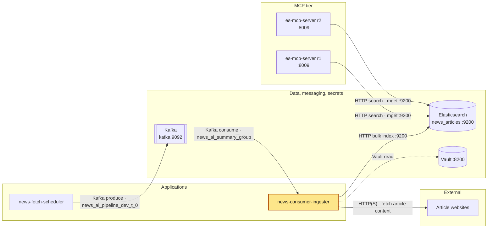

# news-consumer-ingester

## Purpose

A long-running Python worker that consumes news articles from Kafka in batches, fetches each
article's full page text, and bulk-indexes the result into the Elasticsearch index
`news_articles`. Kafka offsets are committed only after a batch has been indexed (or after a
poll in which every message was skipped). It serves no HTTP.

Flow (`src/main.py`): `setup_logging()` → `load_secrets()` (Vault → env) →
`read_config("src/resources/application_config.toml")` →
`BulkMessageProcessor(TOPIC_NAME, INGESTER_BATCH_SIZE).run()`.

| Step | Code | What happens |
|---|---|---|
| Poll | `consumer/bulk_message_processor.py` `poll_batch()` | Polls up to `INGESTER_BATCH_SIZE` (50) messages, each poll waiting `POLL_TIMEOUT_SECONDS` (1.0); stops early when no message is waiting. A message is skipped with an ERROR log (partition and offset, no payload) when it has no key or value, the key or value is not valid UTF-8, the value is invalid JSON or not a JSON object, or a required field (`title`, `summary`, `link`, `published_at`, `fetched_at`, `source`) is missing. Partition EOF and retriable Kafka errors log a warning; other Kafka errors raise `KafkaException`. The message key is stored as `article_id`. |
| Fetch content | `contentfeed/content_feed.py` | For every article in the batch, concurrently (`ThreadPoolExecutor`, `max_workers` 8) GET the `link` within an overall `fetch_budget_seconds` (120). Only `http`/`https` URLs; hosts in `ignore_domains` (matched on hostname or subdomain) are skipped. One shared httpx client (`timeout` 10, `user_agent`, follows redirects). BeautifulSoup strips `nav`, `footer`, `aside`, `script`, `style`, `iframe`, `form`, `ads`, takes `<article>`, `<main>`, a `div` whose class contains "article", or `<body>`, and keeps the first `max_content_chars` (5000) characters. Empty result, error or budget overrun → the article's `summary` is used instead. |
| Index | `ingester/elastic_ingester.py` | `elasticsearch.helpers.bulk` with `_op_type: index`, `_index: ES_INDEX`, `_id: article_id`, so re-indexing the same article overwrites it (idempotent). `BULK` settings from config, `raise_on_error=False`: per-item failures are logged at ERROR (`_id`, status, error type) and then classified by `_is_blocking` against `INDEX_ERRORS`. A **blocking** error (status 401, 403, 404, 429 or any 5xx, or type `strict_dynamic_mapping_exception`, `index_not_found_exception`, `security_exception`, `cluster_block_exception`) is systematic or transient, so `BatchRejected` is raised and the batch is not committed. Every other error is document-level: logged and committed past. A failure of the bulk request itself (including client creation) is logged as `[Indexer] Bulk request failed` and re-raised. |
| Commit | `bulk_message_processor.py` `run()` | `consumer.commit(asynchronous=False)` after indexing returns; it commits the current position of all assigned partitions, so skipped messages in the batch are covered too. A poll in which every message was skipped (`last_poll_consumed` > 0, empty batch) is committed immediately; an empty poll commits nothing. If indexing raised, nothing is committed. |

Each loop pass touches `/tmp/heartbeat` (Docker HEALTHCHECK). Any exception from indexing or
commit (including `BatchRejected`) is not caught: `run()` closes the consumer and the process
exits, and Docker restarts it (`restart: unless-stopped`); the uncommitted batch is re-read.
SIGTERM and SIGINT set a stop flag: the loop stops after the current batch, then closes the
consumer. Under `docker stop` that only works within Docker's 10 s stop grace period; a longer
batch is killed, and its uncommitted messages are re-read on the next start (idempotent by `_id`).

**Indexed document** (`_source`): `article_id`, `title`, `content` (fetched text or summary),
`link`, `published_at`, `fetched_at`, `source`. The Kafka `summary` field is not stored
separately.

**Index mapping** (from the console notes in `src/resources/elastic_schema.MD`; the index is not
created by this repo's code):

| Field | Type | Notes |
|---|---|---|
| `article_id` | `keyword` | MD5 hash from the scheduler; also the `_id` |
| `title` | `text` | `english` analyzer |
| `content` | `text` | `english` analyzer |
| `content.semantic` | `semantic_text` | `inference_id: news-embedding-endpoint` (model `.multilingual-e5-small_linux-x86_64`) |
| `link` | `keyword` | `index: false` (stored, not searchable) |
| `published_at`, `fetched_at` | `date` | `strict_date_optional_time\|\|epoch_millis` |
| `source` | `keyword` | Feed source name |

Settings: `"dynamic": "strict"` (unknown fields are rejected), `refresh_interval: 30s`. The notes
also reindex `news_articles` into `news_articles_v1` and add the alias `news_articles` →
`news_articles_v1`, and include a "serverless mode" error from an Elastic Cloud project. Which of
these (index vs alias, inference endpoint) exists on the local Elasticsearch is UNVERIFIED.

## Where it fits



The ingester is the only application writer of `news_articles`: it turns the scheduler's Kafka messages into
searchable documents that the es-mcp-server replicas read. Full system diagram:
[docker_services architecture](../docker_services/README.md#architecture).

## Depends on / Depended on by

| Direction | Component | How |
|---|---|---|
| Depends on | Vault (`vault-server:8200`) | Reads `secret/CREDENTIALS` at start-up; start fails without it. |
| Depends on | Kafka (`kafka:9092`) | Consumes `news_ai_pipeline_dev_t_0` as group `news_ai_summary_group`. |
| Depends on | news-fetch-scheduler | Producer of the messages (key = article id, value = Article JSON). |
| Depends on | Elasticsearch (`elasticsearch:9200`) | Bulk indexing into `news_articles`, with API key auth. |
| Depends on | Article websites (internet) | Full-text fetch; optional, falls back to summary. |
| Depended on by | es-mcp-server r1/r2 | Read `news_articles` (search, mget). |

## Config & secrets

**Environment variables** (set in `docker-compose.yml`):

| Variable | Value in compose | Purpose |
|---|---|---|
| `VAULT_ADDR` | `http://vault-server:8200` | Vault URL. Required. |
| `VAULT_TOKEN` | `${VAULT_TOKEN}` from your shell | Vault token. Required. |
| `VAULT_SECRET_PATH` | `secret/CREDENTIALS` | KV v2 path(s) under mount `secret`; comma-separated list allowed. Required. |
| `PYTHONPATH` | `src` | Import root. |

**Vault** (`config/vault_secrets.py`): reads every path in `VAULT_SECRET_PATH` and copies **all**
keys found there into the process environment. Key this service uses:

| Key | Used by |
|---|---|
| `ELASTIC_API_KEY` | `config/elastic_setup.py` (`api_key=`); `RuntimeError("ELASTIC_API_KEY is not set")` if empty. The client is created lazily, so this error is raised during the first batch (after its content fetch), logged under `[Indexer] Bulk request failed`, not at start-up. |

**Config files** (`src/resources/`):

| File | Key | Purpose |
|---|---|---|
| `application_config.toml` | `KAFKA` | Passed as-is to `confluent_kafka.Consumer`: `bootstrap.servers=kafka:9092`, `security.protocol=PLAINTEXT`, `group.id=news_ai_summary_group`, `auto.offset.reset=latest`, `enable.auto.commit=false`, `session.timeout.ms` 45000, `heartbeat.interval.ms` 3000, `max.poll.interval.ms` 600000 (10 min; must exceed the worst-case batch, ≈ 374 s per the TOML comment), `socket.keepalive.enable`, `reconnect.backoff.ms` 1000, `reconnect.backoff.max.ms` 10000. |
| | `TOPIC_NAME` | `news_ai_pipeline_dev_t_0` |
| | `INGESTER_BATCH_SIZE` | 50; max messages per poll batch and per bulk call. |
| | `POLL_TIMEOUT_SECONDS` | 1.0; per-poll wait. |
| | `URL` | `http://elasticsearch:9200` |
| | `ES_INDEX` | `news_articles` |
| | `ELASTIC` | Client options: `request_timeout` 60, `retry_on_timeout`, `max_retries` 1, `http_compress`, `connections_per_node` 10. |
| | `BULK` | `bulk()` options: `chunk_size` 50, `max_retries` 3, `initial_backoff` 2, `max_backoff` 60, `request_timeout` 60. |
| | `INDEX_ERRORS` | `blocking_statuses` [401, 403, 404, 429] and `blocking_types` [`strict_dynamic_mapping_exception`, `index_not_found_exception`, `security_exception`, `cluster_block_exception`]; with any 5xx, these per-item errors block the commit. |
| | `CONTENT_FEED` | `user_agent`, `timeout` 10, `max_content_chars` 5000, `max_workers` 8, `fetch_budget_seconds` 120, `ignore_domains` (youtube.com, twitter.com, facebook.com, instagram.com). |
| `logging_config.json` | console + file handlers | Console and `/app/logs/news-consumer-ingester.log` (`TimedRotatingFileHandler`: rotated daily at midnight UTC, 14 days kept) at INFO; root DEBUG; `httpx`/`httpcore` at WARNING. |
| `elastic_schema.MD` | — | Kibana console notes: inference endpoint, index mapping, reindex/alias, sample queries. Not read by code. |
| `test-data.json` | — | Sample articles. Not referenced by `src/` or `tests/`. |

There are no `.env` files; `.env` is in `.dockerignore`.

**Logs:** two copies. (1) The log file `~/github/logs/news-consumer-ingester.log` — the container's `/app/logs`, bind-mounted from `../logs` — rotated daily at midnight UTC with 14 days kept (`<name>.log.YYYY-MM-DD`). (2) The console output, which Docker keeps for `news_consumer_ingester` (`docker logs <container>`), rotated at 3 × 10 MB per container with the oldest file deleted automatically (`logging:` in `docker-compose.yml`). The docker_services log-collector deliberately skips this container, because the log file already exists; see `docker_services/README.md` (Logs).

## Run locally

Prerequisites: the docker_services stack is up in its start order (Vault unsealed, Kafka,
Elasticsearch), the `news_articles` index exists with the mapping above, and the external networks
`vault-network` and `services_network` exist.

**Docker (normal way):**

```bash
export VAULT_TOKEN=...            # your Vault token
docker compose up -d --build      # container: news_consumer_ingester
docker logs -f news_consumer_ingester
```

The image is a two-stage build (`uv sync --frozen --no-dev` in the builder, runtime as non-root
`appuser`). `CMD ["python", "src/main.py"]`. Logs are also written to `../logs` on the host
(bind mount to `/app/logs`).

Health check: every 60s (start period 60s, 3 retries) the container is healthy while
`/tmp/heartbeat` is less than 600s old, in step with `max.poll.interval.ms` (600000). The worst-case
batch is ≈ 614 s, and only when Elasticsearch both stalls and throttles: content fetch budget 120 s +
4 bulk-helper rounds for 429s (`BULK.max_retries` 3) × 2 client attempts per round (`ELASTIC.max_retries` 1)
× `request_timeout` 60 s + backoff 14 s. A normal batch takes seconds.

**On the host (without Docker):**

```bash
uv sync
export VAULT_ADDR=http://vault-server:8200   # host name mapped to 127.0.0.1 in /etc/hosts
export VAULT_TOKEN=...
export VAULT_SECRET_PATH=secret/CREDENTIALS
uv run python src/main.py
```

Caveats from the config: the host name `vault-server` must resolve on the host (e.g. `/etc/hosts`).
`kafka:9092` is the in-network listener; the Kafka container publishes
only `localhost:29092` to the host, so a host run needs a local, uncommitted edit of
`KAFKA."bootstrap.servers"` in `application_config.toml`. Elasticsearch is published on
`127.0.0.1:9200`. If `/app/logs` does not exist, logging falls back to console-only and logs
`Failed to load application logging`.

## Test

```bash
uv sync                      # includes the dev group (pytest, pytest-mock, pytest-cov, mypy)
uv run pytest                # 63 tests
uv run mypy --strict src
```

`pytest.ini` adds `--cov=src --cov-report=term-missing --cov-report=html:coverage-report`, so each
run writes `coverage-report/` (`src/main.py` is omitted via `.coveragerc`). `tests/conftest.py`
loads the real `application_config.toml` for every test; Kafka, Elasticsearch and HTTP are mocked.
Tests mirror `src/` with a `_test.py` suffix.

## Ports

None published, and it serves no HTTP (no listener, no `ports:` in compose). Outbound only:

| Target | Address | Purpose |
|---|---|---|
| Kafka | `kafka:9092` (PLAINTEXT) | Consume articles, commit offsets |
| Elasticsearch | `elasticsearch:9200` (HTTP, API key) | Bulk index |
| Vault | `vault-server:8200` | Secrets at start-up |
| Article websites | HTTP 80 / HTTPS 443 | Full-text fetch |

## Troubleshooting

| Symptom (log line) | Cause | Fix |
|---|---|---|
| `ValueError: VAULT_ADDR and VAULT_TOKEN must be set` / `VAULT_SECRET_PATH must be set` | Env var missing. | `export VAULT_TOKEN` before `docker compose up`; set the others for host runs. |
| `Vault authentication failed - check token information...` | Token invalid or expired. | Use a valid token. |
| Traceback at start-up from `client.is_authenticated()` (e.g. `hvac.exceptions.VaultDown`, `requests.exceptions.ConnectionError`); container restart loop | Vault sealed or unreachable. The check runs outside the `try`, so the error is not wrapped. | Start and unseal Vault; check `vault-server` is on `vault-network`. |
| `Exception while reading secrets from vault :- <error>` | The secret path is missing or unreadable (e.g. `InvalidPath`, `Forbidden`). | Check `VAULT_SECRET_PATH=secret/CREDENTIALS` and the token's policy. |
| `[Indexer] Bulk request failed` with `RuntimeError: ELASTIC_API_KEY is not set` during the first batch; container restarts | Key missing at the Vault path. | Add `ELASTIC_API_KEY` to `secret/CREDENTIALS`. Offsets were not committed, so the batch is re-read. |
| `[Indexer] Bulk request failed` then the process exits and restarts (`restart: unless-stopped`) | Elasticsearch down, unreachable or rejecting the key. | Check `elasticsearch` is up and the key is valid. The batch is re-consumed from the last commit; `_id` makes re-indexing safe. |
| `[Indexer] Failed to index _id=... status=400 error_type=strict_dynamic_mapping_exception` (or `document_parsing_exception`) | Document does not fit the strict mapping (e.g. index created without the mapping, or bad date). | `strict_dynamic_mapping_exception` is blocking (see `INDEX_ERRORS`): the batch is not committed and is retried after each restart until the mapping is fixed. `document_parsing_exception` (status 400) is document-level: that document is committed past and skipped for good; re-publish it to re-index. |
| Scheduler publishes but nothing is indexed, no errors | `auto.offset.reset=latest`: a new consumer group (or expired offsets) starts at the end of the topic and skips older messages. | Expected for a fresh group; reset the group's offsets with Kafka tools if a backfill is needed. |
| `Skipping Kafka message with no key or value ...` / `... not valid UTF-8 ...` / `... invalid JSON ...` | Message not produced by the scheduler format. | None needed; the message is skipped (no crash loop) and committed with the batch, or immediately if every message in the poll was skipped. |
| `Skipping Kafka message missing fields [...]` / `... not a JSON object` | The message lacks a field the ingester reads (`title`, `summary`, `link`, `published_at`, `fetched_at`, `source`) or isn't a JSON object. It is skipped (logged with partition and offset, no payload) and its offset is committed with the batch (or immediately if every message in the poll was skipped). | Fix the producer; null values are accepted, only missing keys are skipped. |
| Restart loop with `[Indexer] N of M index errors are systematic/transient (e.g. status=... error_type=...); not committing` and `BatchRejected` | At least one per-item error is blocking (`INDEX_ERRORS`: status 401/403/404/429 or 5xx, or type `strict_dynamic_mapping_exception`, `index_not_found_exception`, `security_exception`, `cluster_block_exception`): e.g. the strict mapping no longer matches what the scheduler sends, a missing index, an API key without write rights, a read-only cluster, or overload. Offsets are not committed, so nothing is lost; the batch is retried after each restart. Document-level errors are still logged and committed past. | Check the `[Indexer] Failed to index ... error_type=` lines, fix the mapping, index or key, and the ingester catches up on its own. |
| `Kafka non-fatal error on partition ...` | Retriable broker error or partition EOF. | Usually transient; check Kafka if it repeats. |
| `[Article Fetcher] Failed to fetch <url>: ...` | Site blocked the client, timed out, or returned an error status. | None needed; the summary is indexed instead. |
| `[Article Fetcher] Fetch budget exceeded, N articles fall back to summary` | Fetching the batch took longer than `fetch_budget_seconds`. | Raise `fetch_budget_seconds` or `max_workers` in `CONTENT_FEED`. |
| Container `unhealthy` | `/tmp/heartbeat` older than 600s: one batch (fetch + bulk with retries; worst case ≈ 614 s) took over 10 minutes, or the process hung. Beyond `max.poll.interval.ms` (10 min) the consumer also leaves the group. | `docker logs news_consumer_ingester`; restart the container. |
| `Failed to load application logging` | `/app/logs` missing or not writable (host run). | Create the directory, or ignore: console logging still works. |
